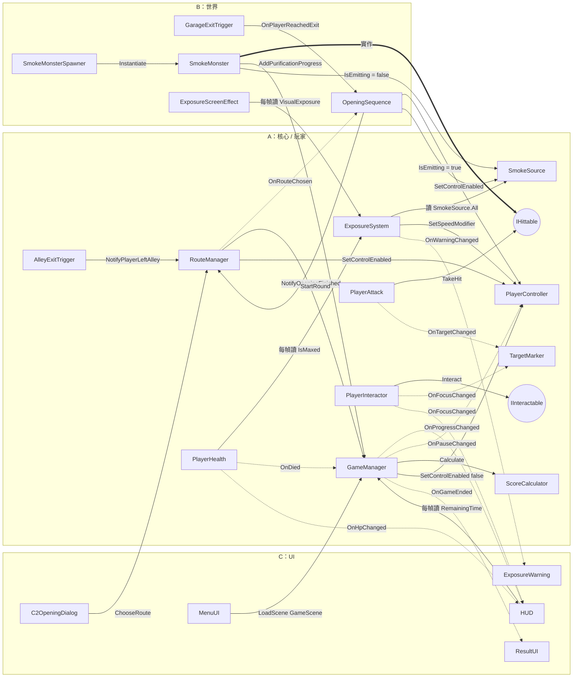

# 01 專案架構地圖（2026-11-19）

> 由 A 的 Claude Code 唯讀閱讀 `Assets/_Project/Scripts/` 全部腳本、`Editor/` 工具與 `UI/InGameMenu.cs` 後整理。
> 「掛在哪」是比對 `.meta` 的 GUID 與場景／Prefab 檔得出的。
> 資料時間點：`develop` = `20f60e4`。

---

## 1. 檔案總表

大部分玩家相關腳本掛在 `Player.prefab` 上（Prefab = 可以重複使用的物件範本），而 Player.prefab 放在 GameScene 與 TestScene_A。「—」表示不用掛（介面、資料型別）或**目前沒掛**。

### A 的檔案（核心、玩家、戰鬥、互動）

| 檔名 | 一句話說明 | 掛在哪 | 場景 |
|---|---|---|---|
| `Core/GameManager.cs` | 整局的總管：狀態、倒數、淨化進度、暫停（Esc）、勝敗結算 | GameManager 物件 | GameScene、TestScene_A、TestScene_C |
| `Core/RouteManager.cs` | 記住選了哪條路線；路線 A 重載場景、路線 B 走出死巷才開始倒數 | RouteManager 物件 | 同上 |
| `Core/AlleyExitTrigger.cs` | 死巷出口的隱形感應區，玩家穿過時通知 RouteManager | 出口 Collider | GameScene、TestScene_A |
| `Core/GameTypes.cs` | 共用的選項清單與資料包：GameState、OpeningRoute、MonsterSize、ItemType、ScoreResult | — | — |
| `Core/ScoreCalculator.cs` | 算分數與評級的計算機 | —（static） | — |
| `Player/PlayerController.cs` | 移動、奔跑、跳躍、滑鼠視角、V 切換人稱、鏡頭防穿牆 | Player.prefab | GameScene、TestScene_A |
| `Player/ExposureSystem.cs` | 依離煙霧距離算暴露值 0–100，80 警示、100 減速 | Player.prefab | 同上 |
| `Player/PlayerHealth.cs` | 血量；暴露值 100 時每秒扣血，歸零發出死亡通知 | Player.prefab | 同上（TestScene_C 也有） |
| `Player/PlayerEffects.cs` | ⬜ 空殼 | — | — |
| `Combat/IHittable.cs` | 介面：「可以被打的東西」 | — | — |
| `Combat/PlayerAttack.cs` | 左鍵揮擊，打前方扇形內最近的 IHittable | Player.prefab | GameScene、TestScene_A |
| `Combat/TargetMarker.cs` | 在攻擊目標／互動目標頭上顯示旋轉倒金字塔 | Player.prefab | 同上 |
| `Interaction/IInteractable.cs` | 介面：「可以按 E 互動的東西」 | — | — |
| `Interaction/PlayerInteractor.cs` | 全專案**唯一讀 E 鍵**的腳本，找最近的 IInteractable 並呼叫它 | Player.prefab | 同上 |
| `Monsters/SmokeSource.cs` | 煙霧來源（半徑、是否冒煙），自動登記到清單 | 菸怪 Prefab、開場吸菸 NPC | GameScene、TestScene_A |

### 🔧 A 的開發者工具（只給開發用，不是遊戲本身）

| 檔名 | 說明 | 場景 |
|---|---|---|
| `DevTools/DevOverlay.cs` | 左上角狀態面板（含結算結果） | GameScene、TestScene_A |
| `DevTools/DevHotkeys.cs` | F1–F10 作弊鍵 | GameScene、TestScene_A |
| `DevTools/DebugExposureWarning.cs` | 暫時的警示紅字（正式版用 C 的 ExposureWarning） | TestScene_A |
| `DevTools/DebugInteractPrompt.cs` | 暫時的互動提示（正式版用 C 的 HUD） | TestScene_A |
| `DevTools/TestDummy.cs` | 假目標方塊，實作 IHittable | TestScene_A |
| `DevTools/TestInteractable.cs` | 假互動方塊，實作 IInteractable | TestScene_A |

DevOverlay、DevHotkeys 只在 GameManager 勾選 `devMode` 時作用。

### B 的檔案（菸怪、開場、NPC、畫面效果）

| 檔名 | 一句話說明 | 掛在哪 | 場景 |
|---|---|---|---|
| `Monsters/SmokeMonster.cs` | 菸怪：被打幾下消散、加淨化進度；實作 IHittable | SmokeMonster_Small／Large.prefab | GameScene |
| `Monsters/SmokeMonsterSpawner.cs` | 開始時從生成點隨機放 4 小 1 大 | 生成器物件 | GameScene |
| `Opening/OpeningSequence.cs` | 開場演出：開門、點菸、路線 A 揮拳倒地／路線 B 進街道 | 開場物件 | GameScene |
| `Opening/GarageExitTrigger.cs` | 車庫出口感應區，通知 OpeningSequence | 出口 Collider | GameScene |
| `VFX/ExposureScreenEffect.cs` | 依暴露值讓畫面變暗變灰（URP Volume） | 效果物件 | GameScene |
| `NPC/EscortNPC.cs`、`GuideLine.cs`、`SafeZone.cs` | ⬜ 空殼 | — | — |
| ⚠️ `Assets/_Project/UI/InGameMenu.cs` | 齒輪暫停選單（OnGUI），放錯資料夾、**沒掛在任何地方** | — | — |

### C 的檔案（UI、道具、問答）

| 檔名 | 一句話說明 | 掛在哪 | 場景 |
|---|---|---|---|
| `UI/MenuUI.cs` | 主選單：開始遊戲（載入 GameScene）、設定面板 | MainMenu 物件 | MainMenu |
| `UI/InfoPage.cs` | 衛教資訊頁開關 | MainMenu 物件 | MainMenu |
| `UI/C2OpeningDialog.cs` | 開場「接受／拒絕香菸」按鈕 | C2OpeningDialog.prefab | GameScene、TestScene_C |
| `UI/HUD.cs` | HP、剩餘時間、淨化進度、互動提示 | HUD.prefab | 同上 |
| `UI/ExposureWarning.cs` | 暴露值 ≥ 80 顯示警示文字 | ExposureWarningText.prefab | 同上 |
| `UI/ResultUI.cs` | 遊戲結束顯示結算畫面 | ResultScreen.prefab | GameScene |
| 🔧 `UI/C2OpeningDialogPreview.cs` | 測試用，顯示「已選擇：○○」 | 測試物件 | TestScene_C |
| `UI/InventoryUI.cs`、`MiniMap.cs` | ⬜ 空殼 | — | — |
| `Items/Inventory.cs`、`HealthItemData.cs` | ⬜ 空殼 | — | — |
| `Quiz/ChestController.cs`、`QuizManager.cs`、`QuizData.cs` | ⬜ 空殼 | — | — |

### 🛠️ Editor 工具（只在 Unity 編輯器用，打包後不存在）

| 檔名 | 擁有者 | 選單 |
|---|---|---|
| `Editor/PlayerSetupTools.cs` | A | `Tools/Smokee/A - …`：建 Player Prefab、TestScene_A、測試物件 |
| `Editor/GameSceneSetupTools.cs` | A（C 有加內容） | `Tools/Smokee/I1 - 組裝 GameScene`、`接受吸菸 - 設定出口揮拳演出` 等 |
| `Editor/ScoreCheckTools.cs` | A | `Tools/Dev/Run Score Checks`：自動檢查評分公式 |
| `Editor/C2OpeningDialogSetup.cs` | C | `C2/…`：TestScene_C 對話框測試 |

---

## 2. 關係圖

圖例：實線 `-->` = 呼叫方法；虛線 `-.->` = 監聽事件（從發出者指向收聽者）；粗線 `==>` = 實作介面。

### 純文字版

**誰呼叫誰**
- C2OpeningDialog → `RouteManager.ChooseRoute()`
- GarageExitTrigger → `OpeningSequence.OnPlayerReachedExit()`
- OpeningSequence → `RouteManager.NotifyOpeningFinished()`、`PlayerController.SetControlEnabled()`、`SmokeSource.IsEmitting = true`
- AlleyExitTrigger → `RouteManager.NotifyPlayerLeftAlley()` → `GameManager.StartRound()`
- RouteManager → `PlayerController.SetControlEnabled()`
- PlayerAttack → `IHittable.TakeHit()`（正式場景 = SmokeMonster）
- SmokeMonster → `GameManager.AddPurificationProgress()`、`SmokeSource.IsEmitting = false`
- SmokeMonsterSpawner → `Instantiate()` 菸怪
- PlayerInteractor → `IInteractable.Interact()`
- ExposureSystem → `PlayerController.SetSpeedModifier()`／`RemoveSpeedModifier()`
- GameManager → `ScoreCalculator.Calculate()`、`PlayerController.SetControlEnabled(false)`
- DevHotkeys → GameManager、RouteManager、PlayerHealth 的方法
- MenuUI → `SceneManager.LoadScene("GameScene")`

**誰每幀主動讀別人的數字（輪詢）**
- ExposureSystem 讀 `SmokeSource.All`
- PlayerHealth 讀 `ExposureSystem.IsMaxed`
- ExposureScreenEffect 讀 `ExposureSystem.VisualExposure`
- HUD 讀 `GameManager.RemainingTime`
- 很多腳本讀 `GameManager.Instance.State`

**誰監聽誰的事件**

| 事件（發出者） | 收聽者 |
|---|---|
| `RouteManager.OnRouteChosen` | OpeningSequence、C2OpeningDialogPreview（測試） |
| `GameManager.OnPauseChanged` | PlayerController |
| `GameManager.OnProgressChanged` | HUD |
| `GameManager.OnGameEnded` | ResultUI |
| `PlayerHealth.OnDied` | GameManager |
| `PlayerHealth.OnHpChanged` | HUD |
| `ExposureSystem.OnWarningChanged` | ExposureWarning、DebugExposureWarning（測試） |
| `PlayerInteractor.OnFocusChanged` | HUD、TargetMarker、DebugInteractPrompt（測試） |
| `PlayerAttack.OnTargetChanged` | TargetMarker |
| 目前沒人聽：`OnRoundStarted`、`OnFinalMinute`、`OnOpeningFinished`、`OnExposureChanged`、`OnMaxedChanged`、`OnAttack`、`OnHit`、`OnViewModeChanged` | 預留給小地圖、音效、特效 |

**誰實作哪個介面**
- `IHittable` ← SmokeMonster（B，正式）、TestDummy（A，測試）
- `IInteractable` ← TestInteractable（A，測試）。正式的 ChestController、EscortNPC 還是空殼

---

## 3. 遊戲流程走一遍

**① 按下 Play**（或主選單 `MenuUI.StartGame()` 載入 GameScene）
- `Awake`：GameManager、RouteManager 登記 `Instance`；GameManager 把 `Time.timeScale` 設回 1、倒數歸 420 秒；ExposureScreenEffect 建立 Volume。
- `Start`：RouteManager 呼叫 `PlayerController.SetControlEnabled(false)`（先不能動、游標放開）；GameManager 訂閱 `PlayerHealth.OnDied`；OpeningSequence 訂閱 `OnRouteChosen`；SmokeMonsterSpawner `SpawnMonsters()`。
- 狀態：`Opening`。

**② 死巷開場**：出現 C2OpeningDialog 對話框。

**③ 選擇路線**：按鈕 → `C2OpeningDialog.AcceptSmoke()`／`RefuseSmoke()` → 對話框隱藏 → `RouteManager.ChooseRoute()` → 發出 `OnRouteChosen` → `OpeningSequence.HandleRouteChosen()`：
- 朋友點菸（粒子播放、`SmokeSource.IsEmitting = true`）
- `OpenDoorSequence()` 開門 → `SetControlEnabled(true)` 玩家可以走
- 頂部顯示新手引導字（OnGUI）

**④ 走到車庫出口**：`GarageExitTrigger.OnTriggerEnter` → `OpeningSequence.OnPlayerReachedExit()`，讀 `RouteManager.ChosenRoute`：

- **路線 A（接受香菸）** → `RouteA_PunchAndRestartRoutine()`
  1. 關控制、鏡頭側拍
  2. 路人跑來揮拳、玩家倒地
  3. 黑幕＋「因為你抽菸臭到路人…」
  4. 3 秒後 `RouteManager.NotifyOpeningFinished()` → `OnOpeningFinished` → `ReloadSceneAfterDelay()` → `SceneManager.LoadScene()` 重載，回到 ①
  - 路線 A 永遠不會開始倒數、也沒有結算。
- **路線 B（拒絕香菸）** → `RouteB_EnterStreetRoutine()`
  1. 呼叫 `RouteManager.NotifyOpeningFinished()`，恢復玩家控制
  2. 走到死巷出口：`AlleyExitTrigger.OnTriggerEnter／OnTriggerStay` → `RouteManager.NotifyPlayerLeftAlley()`（檢查：路線 B、開場已結束、只觸發一次）

**⑤ 開始倒數**：`GameManager.StartRound()`
- 狀態 `Playing`、進度歸 0，發出 `OnProgressChanged(0)`、`OnRoundStarted`
- `GameManager.Update()` → `UpdateCountdown()` 每幀扣時間；`HUD.Update()` 每幀讀 `RemainingTime` 顯示「06:59」
- 剩 60 秒發出 `OnFinalMinute`（目前沒人聽）

**⑥ 靠近菸怪、暴露值上升**：`ExposureSystem.Update()`
- 掃 `SmokeSource.All`，算水平距離、取上升最快的 → `SetExposure()`
- 跨過 80：`OnWarningChanged(true)` → ExposureWarning 顯示警示字
- ExposureScreenEffect 每幀讀 `VisualExposure`，畫面變暗變灰
- 到 100：`SetSpeedModifier("MaxExposure", 0.7)` 減速、`OnMaxedChanged(true)`；`PlayerHealth.Update()` 看到 `IsMaxed` → 每秒 `TakeDamage(5)` → `OnHpChanged` → HUD
- 只有 `Playing` 時才累計 `SmokeSeconds` 和扣血；開場只會變暗、不扣血

**⑦ 攻擊菸怪**：`PlayerAttack.Update()`
- 每幀 `TryFindTarget()`（前方 90 度、2 公尺、沒被牆擋、最近）→ `OnTargetChanged` → TargetMarker 顯示橘色標記
- 左鍵 → `Swing()` → `OnAttack` → `TakeHit(1)` → `SmokeMonster.TakeHit()`（閃一下；小 3 下、大 10 下）
- 打滿 → `SmokeMonster.Die()`：停止冒煙、關碰撞體 → `GameManager.AddPurificationProgress(15 或 40)` → `OnProgressChanged` → HUD；1 秒後消失

**⑧ 勝利或失敗**：都走到 `GameManager.EndGame()`
- 進度 100 → `EndGame(true)`
- 時間 0 → `EndGame(false)`
- HP 0 → `OnDied` → `HandlePlayerDied()` → `EndGame(false)`

**⑨ 結算**：`EndGame()` 依序
1. 狀態改 `Ended`
2. 讀 HP、`SmokeSeconds` → `ScoreCalculator.Calculate()` 算 `ScoreResult`（血量分 ×0.6 ＋ 時間分 ×0.4，加評級）
3. `PlayerController.SetControlEnabled(false)`
4. 發出 `OnGameEnded(result)` → `ResultUI.ShowResult()` 顯示用時、血量、暴露秒數、總分、等級
- 目前結算畫面沒有「重新開始／回主選單」按鈕。

**（隨時）按 Esc**：`GameManager.HandleEscapeKey()` → `SetPaused()` → `Time.timeScale = 0` → `OnPauseChanged` → PlayerController 停止操作並放開游標。

---

## 4. 為什麼要這樣設計

把專案想成一間餐廳。**GameManager 是櫃檯，這局的狀態（時間、進度、勝敗）只記在櫃檯這一份**，別人要知道就來問它（`GameManager.Instance.State`），不會各自抄一份然後抄錯。

**事件像廣播**：PlayerHealth 只負責喊「我死了！」（`OnDied`），不需要知道誰在聽。GameManager 聽到判定失敗，HUD 聽到 `OnHpChanged` 就改數字。之後 B 想加咳嗽音效，只要去聽 `OnMaxedChanged`，**不用改 A 的程式**。

**介面像插座規格**：PlayerAttack 只認「有 `TakeHit()` 插孔的東西」（IHittable）。A 先用 TestDummy 測，B 同時寫 SmokeMonster，最後一插就能用。PlayerInteractor 和 IInteractable 也一樣，C 的寶箱、B 的護送 NPC 照規格做就好。

對三人分工的好處：
1. **可以同時開工**，不用等別人寫完。
2. **各改各的檔案**，Git 比較少衝突。
3. **出錯好找**：狀態只有一份，看 GameManager 就知道哪裡不對。
4. **名字都先寫在 `docs/INTERFACES.md`**，三個 AI 照同一份規格寫，整合（I1）時只要接線、不用重寫。

---

## 5. 初學者可能沒學過的觀念（下一階段再詳細教）

| 觀念 | 一句話 | 專案裡的例子 |
|---|---|---|
| MonoBehaviour 生命週期 | Unity 在特定時機自動呼叫 `Awake`→`OnEnable`→`Start`→每幀 `Update`／`LateUpdate`→`OnDisable`／`OnDestroy` | 每支腳本 |
| 單例（Singleton） | 全場景只有一個，用 `類別.Instance` 到處找得到 | GameManager、RouteManager |
| `static` | 屬於類別本身、大家共用一份 | `SmokeSource.All`、ScoreCalculator |
| 事件 `event Action<T>` | 廣播通知；`+=` 收聽、`-=` 取消、`?.Invoke()` 廣播 | `OnDied`、`OnGameEnded` |
| 介面 `interface` | 規定「必須有哪些方法」的規格書 | IHittable、IInteractable |
| `enum` 列舉 | 固定幾個選項的清單 | GameState、OpeningRoute |
| `struct` 結構 | 把很多數值包成一包 | ScoreResult |
| 屬性 `=>`（property） | 讓外面只能看、不能改 | `RemainingTime => _remainingTime` |
| `[SerializeField]`／`[Header]`／`[Tooltip]` | 私有欄位顯示在 Inspector 可調 | 所有可調數值 |
| 協程 Coroutine（`IEnumerator`、`yield`） | 可以「等幾秒再繼續」的函式 | 開門、揮拳、重載場景 |
| Trigger 觸發器 | 不擋人、只感應有人進來的碰撞體 | AlleyExitTrigger、GarageExitTrigger |
| CharacterController | Unity 內建角色移動元件（非 Rigidbody） | PlayerController |
| 物理偵測（OverlapSphere、Raycast、SphereCast） | 用看不見的球或線掃描附近 | 攻擊、互動、鏡頭防穿牆 |
| LayerMask | 指定哪些圖層算進去的篩選器 | 攻擊、鏡頭碰撞 |
| 新版 Input System | `Keyboard.current.eKey.wasPressedThisFrame` | 所有讀鍵處 |
| `Time.deltaTime`／`Time.timeScale` | 每幀經過幾秒／時間流速（0 = 暫停） | 倒數、暫停 |
| `GetComponent`／`FindFirstObjectByType` | 找同物件的元件／找場景裡的元件 | 「留空會自動找」 |
| Prefab | 可重複使用的物件範本 | Player、菸怪、HUD |
| ScriptableObject | 存成資產檔的資料表 | QuizData、HealthItemData（空殼） |
| OnGUI vs Canvas UI（TextMeshPro） | 舊式程式直接畫 vs 正式 UI 系統 | 開場引導字、DevOverlay vs HUD |
| URP Volume（後製） | 套在整個畫面上的濾鏡 | ExposureScreenEffect |
| 輪詢 vs 事件 | 每幀主動看 vs 等通知 | HUD 讀時間 vs 聽 OnProgressChanged |
| Gizmos | 只在 Scene 視窗看得到的輔助線 | 攻擊扇形、煙霧圈 |
| Editor 腳本（`[MenuItem]`、`#if UNITY_EDITOR`） | 只在編輯器裡跑的工具 | `Editor/` 資料夾 |
| `List`／`Dictionary`／`IReadOnlyList` | 清單、對照表、唯讀清單 | `SmokeSource.All`、速度倍率 |
| `RuntimeInitializeOnLoadMethod` | 每次按 Play 前先執行的清理 | 清掉舊 Instance |

---

## 附註：閱讀時再次確認的待處理事項（未修改）
- InGameMenu 用舊版 `Input.GetKeyDown`、自己讀 Esc（見 00 第 4 節）
- 淨化數值與 DECISIONS 不一致（4 小 ×15％＋1 大 ×40％）
- `SmokeSource.cs` 的 Tooltip 仍寫「預設 50」，已過時
- 結算畫面沒有重新開始／回主選單按鈕

## 交接摘要
已完成專案架構地圖（檔案總表、關係圖、流程、設計理由、觀念清單）。下一階段：從第 5 節觀念清單挑一個開始詳細教（建議先教「生命週期」→「單例」→「事件」→「介面」）。
